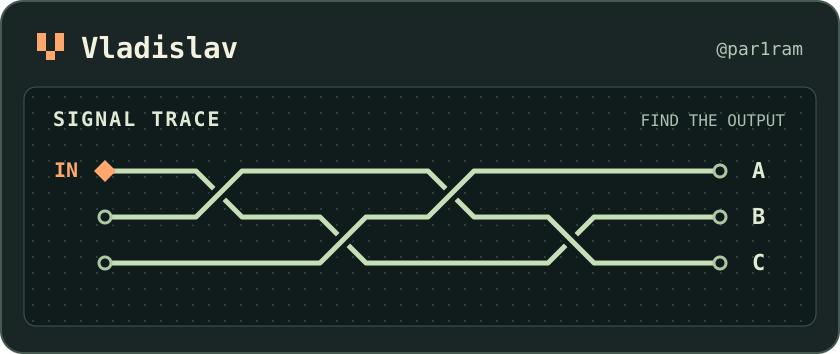

<b>Play Signal Trace</b>

Follow the orange input to its output. At a crossing, stay on the same trace. Open your pick to check it.

<b>Output A</b>

A connects to the bottom input. Try following it backwards from the right edge.

<b>Output B</b>

Signal received! The orange trace drops from the top lane to the middle, then to the bottom, and finally climbs back up to B.

<b>Output C</b>

C connects to the middle input. Look again at the last crossing before the outputs.

### Selected work

| Project | What you’ll find |
| --- | --- |
| [FORMA · ATRIUM 01](https://github.com/par1ram/forma-atrium-01) | Explore a residence in 3D, configure its specifications, and get an estimate. Built with Next.js and Three.js. |
| [E-commerce microservices](https://github.com/par1ram/ecom-microservices) | Go services for accounts, orders, and catalog search, connected through gRPC and a GraphQL gateway. |
| [Stratum V2](https://github.com/stratum-mining/stratum/pulls?q=is%3Apr+author%3Apar1ram+is%3Amerged) | My Rust contributions to coinbase validation and group channel state in the mining protocol libraries. |
